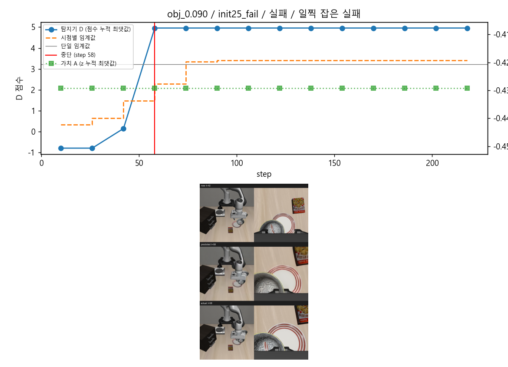

# cosmos-wac

Diffusion 기반 로봇 정책 Cosmos Policy의 내부 hidden feature와 World-Action Consistency(WAC)를 써서 실패를 미리 알아채고, 알아챈 순간 동작을 멈추는 실패 탐지 시스템이다. Diffusion Model 수업 개인 과제다.

Cosmos Policy(`nvidia/Cosmos-Policy-LIBERO-Predict2-2B`)는 행동을 정할 때 16 step 뒤의 카메라 화면, 관절 상태, 가치도 함께 생성한다. 이 예측과 16 step 뒤 실제 관측의 차이(WAC), 초기 노이즈만 바꾼 샘플 사이의 흩어짐, DiT 블록의 hidden feature를 chunk마다 모아 탐지기 D가 실패 확률을 낸다. 비교 기준은 정책이 원래 내는 가치 예측이다. 실험은 LIBERO-Spatial 시뮬레이션에서 한다.

## 결과

eval은 교란 조건마다 100 에피소드, 괄호는 95% 신뢰구간이다.

| | 물체 위치 ±9cm | 손목 카메라 회전 ±50° |
|---|---|---|
| 탐지 AUROC (D / 가치) | 0.982 [0.958, 0.998] / 0.612 | 0.779 [0.681, 0.869] / 0.692 |
| D가 경고한 순간 멈출 때 | 성공 에피소드를 하나도 멈추지 않고 실패 에피소드 동작 27% 줄임 | 성공 에피소드 13%를 잘못 멈춤 |
| 파인튜닝 모델의 D | 0.991 | 0.887 (가치 대비 +0.114 [+0.002, +0.226]) |

물체 위치 교란에서는 탐지와 조기 중단 모두 가설이 지지됐고, 탐지력은 대부분 hidden feature에서 나왔다. 손목 카메라 회전에서는 공개 모델 기준으로 지지되지 않았고, WAC 신호와 미래 프레임 hidden이 더 나았다. 파인튜닝 후 두 조건 모두 D가 올랐지만 차이의 신뢰구간이 0을 포함했다. 자세한 내용은 [Experiment.md](docs/Experiment.md)에 있다.



## 데이터셋

데이터셋은 Hugging Face에 있다.

[MINSUAI/cosmos-wac-libero-spatial](https://huggingface.co/datasets/MINSUAI/cosmos-wac-libero-spatial)

LIBERO-Spatial 지시문 10개에 교란을 넣어 모은 에피소드 500개다. 교란 크기는 성공률이 50% 근처가 되도록 직접 재서 정했다.

| 교란 | 크기 | 에피소드 | 성공률 (calib / eval) |
|---|---|---:|---|
| 물체 위치 (`obj_0.090`) | ±9cm | 250 | 46% / 53% |
| 손목 카메라 회전 (`wristroll_50`) | ±50° | 250 | 57% / 45% |

에피소드마다 시뮬레이션 영상, 파인튜닝용 HDF5(공식 형식), WAC 계산용 생성 latent와 예측값, 추론마다의 '현재 | 예측 | 실제' 그림이 들어 있다. 받는 방법:

```bash
hf download MINSUAI/cosmos-wac-libero-spatial --repo-type dataset --local-dir data/libero_spatial
```

## 문서

| 문서 | 내용 |
|---|---|
| [PROPOSAL.md](docs/PROPOSAL.md) | 과제 제안서. 질문, 신호 정의, 실험 설계, 평가 지표, 결과 요약 |
| [Experiment.md](docs/Experiment.md) | 실험 기록. 교란, 데이터셋, 탐지기, H1~H3 결과 |
| [서버_데이터셋.md](docs/서버_데이터셋.md) | 서버에서 데이터를 모은 절차와 명령 |
| [Training.md](docs/Training.md) | 파인튜닝 데이터, 설정, 고친 문제, 결과 |
| [서버_4090_파인튜닝.md](docs/서버_4090_파인튜닝.md) | RTX 4090 두 장에서 LoRA로 파인튜닝하는 방법 |
| [cosmos-policy-overview.md](docs/cosmos-policy-overview.md) | Cosmos Policy와 diffusion의 동작 원리 |

## 코드

`wac/`에 있다. 공식 Cosmos Policy 코드([NVlabs/cosmos-policy](https://github.com/NVlabs/cosmos-policy))는 고치지 않고 감싸서 쓴다.

| 파일 | 하는 일 |
|---|---|
| `perturbed_eval.py` | 공식 LIBERO 평가에 교란, 실시간 화면, 추론마다의 예측 저장, 에피소드 정리를 붙인 실행기 |
| `server_pipeline.py`, `parallel_runner.py` | 서버에서 교란 크기 찾기와 수집을 여러 GPU로 동시에 돌림 |
| `summarize_split.py` | 묶음별 요약과 전체 목록(`index.csv`) 작성 |
| `encode_actual.py` | 실제 미래 이미지를 VAE로 인코딩해 신호 C 계산 |
| `evaluate.py` | 보정, 탐지기 A~D 학습(과제 단위 교차검증), AUROC와 중단 지표 |
| `make_figures.py` | 조기 탐지, 놓친 실패, 잘못 멈춘 성공 사례 그림 |
| `compare_models.py` | 기본 모델과 파인튜닝 모델의 탐지 비교표 (H3) |
| `run_lora.sh`, `merge_lora.py` | 서버 4090 두 장에서 LoRA 파인튜닝, LoRA를 원래 가중치에 합치기 |
| `ft_collect.sh` | 파인튜닝 모델 수집부터 평가, 비교표, 그림까지 한 번에 |
| `patches/` | 두 GPU 학습이 멈추던 공식 코드의 로그 집계 문제를 고친 패치 |

## 진행 상황

| 단계 | 상태 |
|---|---|
| 교란 크기 정하기, 데이터 수집 | 끝남 (500 에피소드, Hugging Face 공개) |
| hidden feature, WAC 신호 수집 | 끝남 (calib, eval 400 에피소드) |
| 실패 탐지 H1 | 물체 이동 지지 (D 0.982, A 0.612), 손목 회전 지지 안 됨 |
| 조기 중단 H2 | 물체 이동 지지 (오중단 0%, 실패 동작 27% 줄임), 손목 회전 지지 안 됨 |
| 파인튜닝 (LoRA, 1 epoch) | 끝남 |
| 두 모델 비교 H3 | 지지 안 됨 (손목 회전 D +0.108, 구간이 0 포함) |
