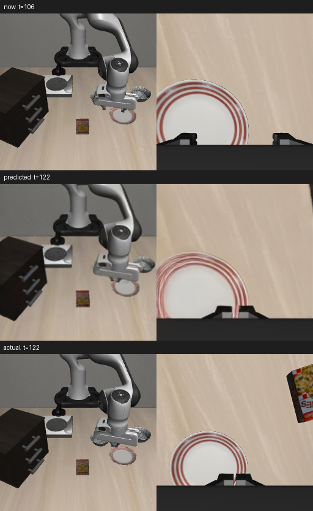

# 실험 기록

마지막 갱신: 2026-11-20

## 1. 목표와 가설

Cosmos Policy [1]는 행동을 정할 때 16 step 뒤의 카메라 화면, 관절, 가치를 함께 생성한다. 이 실험은 정책 내부의 hidden feature와, 이 예측과 실제 관측의 일치도(World-Action Consistency, WAC)를 함께 써서 실패를 미리 알아채고, 알아챈 순간 동작을 멈춰 불필요한 동작을 줄일 수 있는지 확인한다.

| 가설 | 내용 | 확인 방법 |
|---|---|---|
| H1 (핵심) | hidden feature와 WAC 신호를 함께 쓰는 탐지기 D는 실패할 에피소드를 성공할 에피소드와 구분하고, 정책 자체의 가치 예측보다 더 잘, 더 일찍 구분한다 | 기록된 에피소드에서 오프라인으로 잰다 (5장) |
| H2 | D가 경고한 순간 멈추면, 성공 에피소드를 거의 멈추지 않으면서 실패 에피소드의 동작을 크게 줄인다 | 같은 기록에서 중단 시점을 계산한다 (6장) |
| H3 | 교란 조건의 성공·실패 rollout으로 파인튜닝한 모델에서는 D가 더 잘 구분한다 | 두 모델의 탐지 성능을 비교한다 (7장) |

실험 방식은 hidden feature로 실패를 탐지한 SAFE [9]와, 성공 에피소드로 보정하고 conformal 임계값을 쓴 FAIL-Detect [7]를 따른다.

### 진행 상황

| 단계 | 상태 |
|---|---|
| 교란 조건과 크기 결정 (3장) | 끝남 |
| 데이터 수집 500 에피소드 (4장) | 끝남. Hugging Face 공개 |
| 실제 이미지 인코딩 (5.2절) | 끝남 |
| hidden feature, 샘플 간 흩어짐 수집 (5.1절) | 끝남. calib, eval 400 에피소드 |
| 탐지 평가 H1 (5장) | 끝남. 물체 이동은 지지, 손목 회전은 지지 안 됨 (5.7절) |
| 파인튜닝 (7.1절) | 끝남. LoRA 합친 체크포인트 |
| 조기 중단 H2 (6장) | 끝남. 물체 이동은 지지, 손목 회전은 지지 안 됨 (6.3절) |
| 두 모델 탐지 비교 H3 (7.2절) | 끝남. 지지 안 됨. 손목 회전 D가 +0.108 올랐지만 구간이 0을 포함 (7.3절) |

## 2. 실험 설정

### 2.1 환경과 정책

LIBERO-Spatial [2]의 지시문 10개를 쓴다. 정책은 공개 체크포인트 `nvidia/Cosmos-Policy-LIBERO-Predict2-2B`이고, 설정은 공식 LIBERO 평가 [1]와 같다.

| 항목 | 값 |
|---|---|
| denoising step | 5 |
| 행동 chunk | 16 step을 생성하고 16 step을 모두 실행한 뒤 다시 추론 |
| 입력 | 3인칭, 손목 카메라 224×224 (JPEG q95), 관절 9차원, 지시문 T5 임베딩 |
| 최대 step | 220 (처음 10 step은 물체가 자리 잡게 대기) |
| 정책 seed | 195, `--deterministic True` |

교란이 없을 때 공개 체크포인트의 LIBERO-Spatial 성공률은 98.1%로 보고됐다 [1, 표 1]. 노트북에서 지시문마다 1번씩 돌렸을 때 10/10 성공했다.

### 2.2 지시문

| D | 지시문 |
|---|---|
| D1 | pick up the black bowl between the plate and the ramekin and place it on the plate |
| D2 | pick up the black bowl next to the ramekin and place it on the plate |
| D3 | pick up the black bowl from table center and place it on the plate |
| D4 | pick up the black bowl on the cookie box and place it on the plate |
| D5 | pick up the black bowl in the top drawer of the wooden cabinet and place it on the plate |
| D6 | pick up the black bowl on the ramekin and place it on the plate |
| D7 | pick up the black bowl next to the cookie box and place it on the plate |
| D8 | pick up the black bowl on the stove and place it on the plate |
| D9 | pick up the black bowl next to the plate and place it on the plate |
| D10 | pick up the black bowl on the wooden cabinet and place it on the plate |

### 2.3 장비와 소프트웨어

| 항목 | 값 |
|---|---|
| 서버 | OASYS, RTX 4090 24GB × 4 (드라이버 580.173.02), CPU 32코어, Ubuntu 24.04 |
| 수집과 인코딩 | GPU 2, 3번 |
| 파인튜닝 | GPU 0, 1번 |
| Python, PyTorch | 3.10, 2.7.0 (CUDA 12.8) |
| 시뮬레이터 | MuJoCo 3.3.2, robosuite 1.4.0, LIBERO 0.1.1 |
| 공식 코드 | NVlabs/cosmos-policy 커밋 `18a2acc` |
| 정책 체크포인트 | Hugging Face 리비전 `cb689ec` |
| VAE (Cosmos-Predict2-2B-Video2World) | Hugging Face 리비전 `f50c09f` |

### 2.4 무작위성 통제

한 에피소드는 지시문, LIBERO 초기 상태 번호, 교란 seed, 정책 seed로 완전히 정해진다. 정책은 deterministic 모드라서 이 네 값이 같으면 같은 에피소드가 나온다. 교란 난수는 (교란 seed, 지시문 번호, 초기 상태 번호)로 만들어, 작업을 여러 프로세스로 나눠 돌려도 같은 교란이 나온다. 6장의 개입 실험은 이 성질을 써서 같은 에피소드를 개입 조건만 바꿔 다시 돌린다.

## 3. 교란 설계

### 3.1 교란 조건

한 에피소드에는 교란을 하나만 넣는다.

| 조건 | 내용 | 크기 |
|---|---|---|
| 물체 위치 (`obj_0.090`) | 움직일 수 있는 물체(검은 그릇 2개, 접시, ramekin, 쿠키 상자)의 초기 위치 (x₀, y₀)를 (x₀ + dx, y₀ + dy)로 옮긴다. dx, dy는 물체마다 −9~+9cm 균등분포에서 따로 뽑는다 | ±9cm |
| 손목 카메라 회전 (`wristroll_50`) | 손목 카메라를 광축 둘레로 돌린다. 방향은 무작위 | ±50° |

물체의 높이, 회전, 고정물(캐비닛, 스토브), 로봇 시작 자세는 바꾸지 않는다. 물체가 겹치면 처음 10 step 대기 동안 물리 시뮬레이션이 자리를 잡는다. 에피소드마다 실제 이동량은 `episodes.jsonl`의 `objects`에 남는다.

### 3.2 성공률 목표를 50%로 둔 이유

교란이 없으면 성공률이 98.1%라서 실패 사례가 거의 없다 [1]. 교란 크기를 조절해 성공률을 50% 근처로 맞춘 이유는 세 가지다.

- 에피소드 수가 정해져 있을 때 AUROC의 표준오차는 실패 수와 성공 수가 같을 때 가장 작다 [3]. eval 묶음은 조건마다 100개라서 실패와 성공이 50개씩 들어간다.
- AUPRC는 무작위로 순위를 매겼을 때 값이 실패 비율과 같다 [4]. 50%면 기준선이 0.5다.
- 보정에는 성공 에피소드가, 개입 실험과 파인튜닝에는 실패 에피소드가 충분히 있어야 한다.

PROPOSAL 5.1은 목표를 50~70%로 적었지만, 위 이유로 50%를 목표로 했다.

### 3.3 크기를 정한 방법

1. 후보 크기마다 지시문 10개 × 초기 상태 0, 1번 = 20번 돌렸다. 교란 seed는 9000이다.
2. 성공률이 40~60%인 후보 중 50%에 가장 가까운 크기를 골랐다. 없으면 범위를 넓히거나 사이를 더 잘게 나눠 다시 쟀다.
3. 고른 크기를 본수집에 쓰지 않는 초기 상태 두 묶음(30~34번 seed 19001, 35~39번 seed 19002)에서 50번씩 다시 쟀다. 두 묶음 모두 40~60%에 들면 확정했다.

같은 초기 상태와 seed에서는 크기만 달라지고 이동 방향과 비율은 같다. 그래서 후보 사이의 성공률 차이는 교란 크기 차이에서 나온다. 20번으로 잰 성공률은 5%p 단위로만 움직이고 신뢰구간이 넓어서, 2단계는 후보를 고르는 용도로만 쓰고 3단계에서 확정했다.

### 3.4 결과

**물체 위치 (1단계, 20번씩)**

| 크기 | 성공 | 성공률 | 95% 신뢰구간 |
|---|---:|---:|---:|
| ±8cm | 12/20 | 60% | 38.7~78.1% |
| ±9cm | 9/20 | 45% | 25.8~65.8% |
| ±10cm | 7/20 | 35% | 18.1~56.7% |
| ±11cm | 7/20 | 35% | 18.1~56.7% |
| ±12cm | 4/20 | 20% | 8.1~41.6% |

**3인칭 카메라 회전 (1단계, 20번씩)**

15도부터 180도까지 22개 각도를 쟀고, 성공률은 65%(135°)~95%(15°, 75°)였다. 가장 낮았던 135°도 다른 초기 상태(5~9번)에서는 39/50회 성공했다(78%, 64.8~87.2%). 회전에 10~90cm 평행이동을 더해 8개 거리를 시험했을 때도 가장 낮은 값이 15/20회(75%, 53.1~88.8%)였다. 3인칭 시점 변화로는 50% 근처에 도달하지 못해 이 조건은 쓰지 않았다. 각도별 결과는 부록 A에 있다.

**손목 카메라 회전 (1단계, 20번씩)**

| 각도 | 성공 | 성공률 | 95% 신뢰구간 |
|---|---:|---:|---:|
| ±10° | 20/20 | 100% | 83.9~100% |
| ±20° | 16/20 | 80% | 58.4~91.9% |
| ±30° | 15/20 | 75% | 53.1~88.8% |
| ±45° | 11/20 | 55% | 34.2~74.2% |
| ±60° | 6/20 | 30% | 14.5~51.9% |
| ±90° | 6/20 | 30% | 14.5~51.9% |

**확인 (3단계, 50번씩)**

| 후보 | 초기 상태 | 교란 seed | 성공 | 성공률 | 95% 신뢰구간 |
|---|---|---:|---:|---:|---:|
| 물체 ±9cm | 30~34 | 19001 | 24/50 | 48% | 34.8~61.5% |
| 물체 ±9cm | 35~39 | 19002 | 21/50 | 42% | 29.4~55.8% |
| 손목 카메라 ±45° | 30~34 | 19001 | 22/50 | 44% | 31.2~57.7% |
| 손목 카메라 ±45° | 35~39 | 19002 | 31/50 | 62% | 48.2~74.1% |
| 손목 카메라 ±50° | 30~34 | 19001 | 23/50 | 46% | 33.0~59.6% |
| 손목 카메라 ±50° | 35~39 | 19002 | 28/50 | 56% | 42.3~68.8% |

손목 카메라 ±45°는 두 번째 묶음에서 62%로 범위를 벗어나 ±50°로 다시 쟀다. 두 묶음 모두 40~60%에 든 물체 ±9cm와 손목 카메라 ±50°를 확정했다.

모든 신뢰구간은 Wilson score interval이다 [5]. 성공/실패처럼 결과가 둘뿐인 시행에서 성공률의 범위를 구하는 방법으로, 시행 수가 적거나 성공률이 0%나 100%에 가까워도 구간이 0~100% 안에 있고 실제 포함 확률이 95%에 가깝다 [6]. n번 중 k번 성공했을 때(p = k/n, z = 1.96):

```
중심 = (p + z²/(2n)) / (1 + z²/n)
반폭 = z · √( p(1−p)/n + z²/(4n²) ) / (1 + z²/n)
```

지시문마다 난이도가 다른 점은 이 구간에 반영하지 않았다.

## 4. 데이터셋

### 4.1 구성

| 묶음 | 초기 상태 | 교란 seed | 지시문당 (조건마다) | 용도 |
|---|---|---:|---:|---|
| calib | 10~19 | 2 | 10 | 탐지기 보정과 임계값 (성공 에피소드), 조건 D 학습 |
| eval | 20~29 | 3 | 10 | 탐지 평가와 개입 실험 |
| train | 0~4 | 1 | 5 | 파인튜닝 |

세 묶음은 초기 상태와 seed가 겹치지 않고, 크기를 정할 때 쓴 초기 상태(0~1, 5~9, 30~39번)와 seed(9000, 19001, 19002)와도 calib, eval은 겹치지 않는다. train은 초기 상태 0~4번을 쓰지만 seed가 달라서 교란이 다르다.

### 4.2 수집 결과

| 조건 | 묶음 | 성공 | 성공률 | 95% 신뢰구간 |
|---|---|---:|---:|---:|
| 물체 ±9cm | calib | 46/100 | 46% | 36.6~55.7% |
| 물체 ±9cm | eval | 53/100 | 53% | 43.3~62.5% |
| 물체 ±9cm | train | 31/50 | 62% | 48.2~74.1% |
| 손목 카메라 ±50° | calib | 57/100 | 57% | 47.2~66.3% |
| 손목 카메라 ±50° | eval | 45/100 | 45% | 35.6~54.8% |
| 손목 카메라 ±50° | train | 24/50 | 48% | 34.8~61.5% |

calib과 eval은 두 조건 모두 성공률이 40~60%였다. 전체 500 에피소드를 [Hugging Face](https://huggingface.co/datasets/MINSUAI/cosmos-wac-libero-spatial)에 공개했다.

### 4.3 저장 내용

```
data/libero_spatial/<조건>/<묶음>/D<번호>_<지시문>/
  result.md, predictions.csv, episodes.jsonl
  init<번호>_<succ|fail>.mp4      시뮬레이션 영상
  init<번호>_<succ|fail>.hdf5     관측 이미지, 관절, 행동 (공식 형식)
  init<번호>_<succ|fail>.npz      chunk마다 가치, 예측 관절, 생성 latent, 실제 관절
  init<번호>_<succ|fail>_frames/  chunk마다 '현재 | 예측 | 실제' 그림
```

HDF5의 i번째 관측은 step i+10이다(처음 10 step 대기는 저장되지 않는다). npz의 실제 관절은 step 0부터 저장된다.

## 5. 실패 탐지기 (H1)

### 5.1 신호

chunk를 step t에 추론했다면, 정책은 그때 t+16의 관절, 손목 이미지, 3인칭 이미지, 가치를 함께 생성한다. 이 예측과 t+16의 실제 관측을 비교한다.

| 조건 | 신호 | 계산 | 알 수 있는 시점 |
|---|---|---|---|
| A | 가치 | 1 − V̂ | 추론 직후 |
| B | 관절 차이 | 예측 관절과 실제 관절의 거리 (공식 정규화 공간, 9차원) | 16 step 실행 후 |
| C | 이미지 차이 | 예측 latent와 실제 이미지 latent의 평균 제곱 오차 (손목과 3인칭 평균) | 16 step 실행 후 |
| F | 샘플 간 흩어짐 | 같은 입력에서 초기 노이즈만 바꾼 4개 표본의 미래 이미지 latent 분산 | 추론 직후 |
| H | hidden feature | DiT 블록 7, 14, 21, 28번째 출력(마지막 denoising step)을 공간과 프레임에 대해 평균 | 추론 직후 |
| O | hidden 분포 이탈 | calib 성공 에피소드의 H를 PCA 16차원으로 줄인 분포에서 떨어진 정도(차원별 분산으로 나눈 제곱 거리). FIPER [10]의 관측 OOD 점수에 해당한다 | 추론 직후 |

H는 모든 프레임 평균 외에 현재 관측 프레임(1~3)과 미래 예측 프레임(5~8)의 평균을 따로 저장한다. world model이 그리는 미래 쪽 표현이 실패를 더 일찍 알려 주는지 보려는 것으로, Foresight [11]가 world model latent로 실패를 탐지한 것과 같은 질문이다. O는 calib 성공 에피소드에 대해서는 5묶음으로 나눠 자기 묶음을 뺀 분포로 잰다.

예측 관절은 생성 latent의 미래 관절 프레임에서 반복된 값을 평균 내어 꺼낸다. 실제 관절은 공식 코드와 같이 데이터셋 min, max로 −1~1로 바꿔 같은 공간에서 비교한다. 에피소드가 끝나 16 step 뒤가 없는 마지막 chunk는 B, C를 계산하지 않는다.

### 5.2 실제 이미지를 같은 공간으로 옮기기

Wan2.1 VAE는 시간 방향으로 causal이라 같은 이미지라도 앞 프레임에 따라 latent가 달라진다. 그래서 실제 이미지를 따로 인코딩하지 않고 정책이 추론 때 만든 33장 시퀀스와 같은 자리에 넣는다(`wac/encode_actual.py`).

```
0 빈 1장 | 1 관절 자리 ×4 | 2 현재 손목 ×4 | 3 현재 3인칭 ×4 | 4 행동 자리 ×4
5 미래 관절 자리 ×4 | 6 실제 미래 손목 ×4 | 7 실제 미래 3인칭 ×4 | 8 가치 자리 ×4
```

빈 자리는 검은 이미지다. 정책과 같은 전처리(JPEG q95, 224 리사이즈, 90% 가운데 자르기)를 거쳐 −1~1로 바꾸고 `model.encode`에 넣어 6, 7번 latent를 얻는다. 공식 코드가 생성 latent를 그대로 `model.decode`에 넣으므로 두 latent는 같은 공간에 있다.

저장된 HDF5 이미지는 이미 JPEG로 한 번 압축됐고 전처리에서 한 번 더 압축된다. 정책이 본 이미지(한 번 압축)와 조금 다르지만 이 차이는 성공과 실패 에피소드에 똑같이 들어간다.

### 5.3 보정과 점수

신호의 평소 크기는 지시문마다, 에피소드의 앞뒤마다 다르다. calib 묶음의 성공 에피소드에서 지시문 d와 chunk 순번 k별로 평균 μ와 표준편차 σ를 구해 z-score로 바꾸고, 지금까지의 최댓값을 에피소드 점수로 쓴다. 성공 에피소드만으로 보정하는 방식은 FAIL-Detect [7]를 따랐다.

```
z_k = (d_k − μ_{d,k}) / σ_{d,k}
R_k = max(z_1, …, z_k)
```

성공 에피소드는 일찍 끝나서 뒤쪽 chunk일수록 표본이 줄어든다. (d, k) 칸에 성공 에피소드가 5개보다 적으면 같은 지시문의 k 이하 순번을 합치고, 그래도 적으면 같은 k에서 모든 지시문을 합친다. σ에는 calib 전체 σ의 10%를 하한으로 둔다. 이 값들은 calib만 보고 정하고 평가 전에 고정한다.

### 5.4 임계값

calib 성공 에피소드의 최종 점수 R의 95% 분위수를 임계값으로 쓴다. 성공 에피소드의 약 5%만 넘도록 맞추는 것으로, conformal prediction [8]의 기본 절차와 같다.

### 5.5 탐지기 D

chunk k를 실행하기 직전에 알 수 있는 정보를 모두 함께 쓰는 탐지기다. 가치, 샘플 간 흩어짐, hidden 분포 이탈은 이번 chunk 값(A_k, F_k, O_k), 관절과 이미지 차이는 직전 chunk 값(B_{k−1}, C_{k−1})을 쓴다. 그래서 오프라인 평가가 실시간으로 돌렸을 때와 같은 정보만 쓴다.

D는 두 단계로 만든다(stacking). 먼저 WAC 신호의 z-score를 넣은 logistic regression(D-WAC)과 hidden feature를 PCA로 줄여 넣은 logistic regression(D-hidden)을 따로 학습한다. 다음으로 두 모델이 chunk마다 낸 점수를 입력으로 받는 2변수 logistic regression이 둘을 합친다. 결합 가중치는 학습 묶음 안에서 지시문 단위로 빼고 낸 점수(out-of-fold)로 맞춰, 자기 학습 데이터에서 부풀려진 점수에 기대지 않게 한다.

처음에는 WAC 신호와 hidden PCA 성분을 한 회귀에 바로 넣었다(D-concat). 이 방식은 변수가 최대 37개인데 calib이 조건마다 100개(지시문 10개)라, 성분을 잘 쓰는 D-hidden이나 D-WAC보다 낮게 나왔다. stacking은 이럴 때 쓰기로 미리 정해 둔 대안이고, D-concat은 비교용으로 결과에 남긴다. hidden 쪽은 현재 프레임만 쓴 D-hidden-now, 미래 프레임만 쓴 D-hidden-future도 같은 방식으로 학습해 비교한다.

PCA 차원(4, 8, 16, 32)과 L2 세기(0.01, 0.1, 1, 10)는 학습 묶음 안의 지시문 단위 4묶음 내부 교차검증 AUROC로 고른다. PCA와 표준화도 학습 묶음의 calib으로만 맞춘다. 실패 라벨로 학습하므로 calib으로 학습하고 eval로 평가한다. 지시문 10개를 5묶음으로 나눠, 평가하는 지시문은 학습에서 뺀다. 같은 지시문이 학습과 평가에 같이 들어가면 그 지시문의 특징을 외워 성능이 부풀려지기 때문이다. 실패 에피소드는 최대 길이까지 가서 chunk가 많으므로 chunk마다 1/(그 에피소드의 chunk 수) 가중치를 준다. 임계값은 각 묶음의 모델로 만든 calib 성공 에피소드 점수에서 같은 방식으로 정한다.

### 5.6 평가 지표

eval 묶음에서 교란 조건마다 따로 잰다.

| 지표 | 정의 |
|---|---|
| AUROC, AUPRC | 에피소드 최종 점수로 실패(양성)와 성공을 구분하는 정도 |
| 시점별 AUROC | k번째 chunk까지만 본 점수 R_k로 계산. 이미 끝난 성공 에피소드는 끝난 시점의 점수를 그대로 쓴다 |
| 오경보율 | 임계값을 넘은 성공 에피소드의 비율 |
| 탐지율, 탐지 시점 | 임계값을 넘은 실패 에피소드의 비율, 처음 넘은 step |
| 살아 있는 에피소드끼리의 AUROC | k번째 chunk까지 끝나지 않은 에피소드만으로 R_k의 AUROC. 실패 에피소드가 더 오래 돌아서 점수가 커지는 효과를 뺀다 |

모든 지표에 에피소드 단위 bootstrap(2,000번)으로 95% 신뢰구간을 붙인다. 신호끼리는 같은 에피소드에서 AUROC 차이를 paired bootstrap으로 구해 신뢰구간이 0을 포함하는지 본다. 비교군은 정책 자체의 가치 예측(A)이다.

### 5.7 결과

calib, eval 각 100개, 공개 모델 결과다. 괄호는 95% 신뢰구간, 마지막 열은 같은 에피소드에서 잰 A와의 AUROC 차이다(`results/detection_base_full_v2.json`).

| 탐지기 | 물체 이동 ±9cm (실패 47) | A 대비 | 손목 카메라 회전 50° (실패 55) | A 대비 |
|---|---|---|---|---|
| A (가치) | 0.612 [0.504, 0.723] | | 0.692 [0.582, 0.791] | |
| D | 0.982 [0.958, 0.998] | +0.370 [+0.261, +0.481] | 0.779 [0.681, 0.869] | +0.086 [−0.058, +0.237] |
| D-concat | 0.930 [0.878, 0.972] | +0.318 | 0.775 [0.671, 0.862] | +0.083 |
| D-WAC | 0.886 [0.812, 0.948] | +0.274 | 0.832 [0.741, 0.914] | +0.140 [+0.000, +0.290] |
| D-hidden | 0.988 [0.971, 0.999] | +0.376 | 0.781 [0.685, 0.865] | +0.089 |
| D-hidden-now | 0.988 [0.966, 1.000] | +0.376 | 0.798 [0.709, 0.876] | +0.105 |
| D-hidden-future | 0.984 [0.952, 1.000] | +0.371 | 0.829 [0.747, 0.904] | +0.137 [−0.006, +0.280] |

물체 이동에서는 H1이 지지된다. D는 0.982로 가치보다 0.37 높고 신뢰구간이 0에서 멀다. 이 조건의 정보는 대부분 hidden feature에서 왔다. D-hidden만으로 0.988이고, 결합 가중치도 D-hidden 0.99, D-WAC 0.44로 hidden 쪽이 컸다.

손목 카메라 회전에서는 H1이 지지되지 않는다. D는 0.779로 가치보다 높지만 신뢰구간이 0을 포함한다. 이 조건에서는 WAC 신호(D-WAC 0.832)와 미래 프레임 hidden(D-hidden-future 0.829)이 나았고, 둘 다 A 대비 차이의 하한이 0 근처였다. 손목 카메라가 돌아가면 정책이 보는 이미지 자체가 바뀌어 성공 에피소드의 hidden도 크게 움직인다. 그래서 hidden만으로는 실패와 구분이 덜 되는 것으로 보인다. 미래 프레임 hidden이 현재 프레임보다 나은 것(0.829 대 0.798)은 Foresight [11]의 관찰과 방향이 같지만, 차이는 신뢰구간 안이다.

같은 시점까지 살아 있는 에피소드끼리 본 AUROC(k = 2, 4, 6, 8번째 chunk)는 아래와 같다.

| 탐지기 | 물체 이동 | 손목 회전 |
|---|---|---|
| A | 0.66, 0.64, 0.60, 0.47 | 0.70, 0.67, 0.65, 0.58 |
| D | 0.47, 0.72, 0.76, 0.86 | 0.23, 0.45, 0.44, 0.56 |
| D-WAC | 0.51, 0.69, 0.74, 0.85 | 0.36, 0.62, 0.65, 0.59 |

물체 이동에서 D는 4번째 chunk(약 64 step)부터 가치를 앞선다. 2번째 chunk에서는 어떤 학습 탐지기도 가치보다 낫지 않았다. hidden feature와 샘플 간 흩어짐을 넣어도 첫 한두 chunk의 조기 탐지는 개선되지 않았다. 손목 회전에서는 끝까지 가치가 앞서거나 비슷했다.

## 6. 조기 중단 (H2)

### 6.1 설계

D의 점수가 임계값을 넘은 chunk를 실행하기 직전에 에피소드를 멈춘다고 보고, 기록된 eval 에피소드에서 결과를 계산한다. 멈추기 전까지는 기록과 똑같이 진행되므로 시뮬레이션을 다시 돌릴 필요가 없다.

| 지표 | 정의 |
|---|---|
| 아낀 동작 | 실패 에피소드에서 멈춘 뒤 남은 step의 합 ÷ 실패 에피소드 전체 step |
| 오중단율 | 멈춘 성공 에피소드의 비율 |
| 중단 후 성공률 | 끝까지 갔다면 성공했고 멈추지 않은 에피소드의 비율 |

임계값은 두 가지로 잰다. 하나는 calib 성공 에피소드 최종 점수의 95% 분위수 하나, 다른 하나는 chunk 순번마다 calib 성공 에피소드 점수의 95% 분위수를 따로 두는 시점별 임계값이다. 시점별 임계값은 SAFE [9]와 FAIL-Detect [7]가 쓴 방식이다.

### 6.2 판단 기준

H2는 오중단율이 calib에서 정한 수준(약 5%) 근처에 머물면서 아낀 동작이 가치(A)로 멈출 때보다 많을 때 지지된다.

### 6.3 결과

5.7과 같은 eval 에피소드다. 앞은 단일 임계값, 괄호 안은 시점별 임계값 결과다.

| 조건 | 탐지기 | 오중단율 | 탐지율 | 아낀 동작 | 성공률 (중단 전 → 후) |
|---|---|---|---|---|---|
| 물체 이동 | A | 0.09 (0.09) | 0.21 (0.21) | 0.18 (0.18) | 0.53 → 0.48 (0.48) |
| 물체 이동 | D | 0.00 (0.09) | 0.64 (0.68) | 0.27 (0.32) | 0.53 → 0.53 (0.48) |
| 물체 이동 | D-WAC | 0.23 (0.25) | 0.85 (0.77) | 0.48 (0.48) | 0.53 → 0.41 (0.40) |
| 손목 회전 | A | 0.07 (0.09) | 0.27 (0.38) | 0.22 (0.32) | 0.45 → 0.42 (0.41) |
| 손목 회전 | D | 0.13 (0.27) | 0.40 (0.33) | 0.13 (0.14) | 0.45 → 0.39 (0.33) |
| 손목 회전 | D-WAC | 0.20 (0.29) | 0.73 (0.62) | 0.39 (0.40) | 0.45 → 0.36 (0.32) |

물체 이동에서는 H2가 지지된다. D는 성공 에피소드를 하나도 멈추지 않으면서 실패 에피소드의 64%를 멈췄고, 실패 동작의 27%를 아꼈다(가치 18%). 성공률은 그대로 0.53이다. 탐지 시점의 중앙값은 154 step으로, 최대 길이 220 step의 약 70% 지점이다. 일찍 멈춘 예와 놓친 예는 `docs/figures/`에 있다.

손목 회전에서는 H2가 지지되지 않는다. 어느 탐지기도 오중단율이 calib에서 맞춘 5% 근처에 머물지 않았다. 가치(A)보다 많이 아낀 D-WAC는 성공 에피소드의 20%를 멈췄다. calib과 eval은 초기 상태가 달라, 성공 에피소드의 점수 분포가 손목 회전에서 특히 많이 달라진 것으로 보인다. 시점별 임계값은 두 조건 모두 단일 임계값보다 오중단을 늘렸다. chunk별 성공 에피소드가 적은 뒤쪽 순번에서 분위수가 불안정해서다.

## 7. 파인튜닝과 두 모델 비교 (H3)

### 7.1 파인튜닝

공개 체크포인트에서 시작해 train 묶음 rollout 100개(성공 55, 실패 45, 16,054 step)와 공식 LIBERO-Spatial 시연 430개로 world model과 가치 예측을 더 학습한다. 실행 명령은 [서버 4090 파인튜닝](서버_4090_파인튜닝.md)에 있다.

| 항목 | 값 |
|---|---|
| 장비 | RTX 4090 0, 1번 (DDP) |
| 방식 | LoRA, rank 8, alpha 8, 학습률 2e-5 |
| 배치 | GPU당 4 × 2장 × 누적 4 = 유효 배치 32 |
| 시연 샘플 비율 | 25% |
| 학습량 | 1 epoch, 샘플 210,432개, 갱신 6,576번 |
| 체크포인트 | 1,096번마다 저장 (6개, 하나에 3.8GB) |
| 기록 | run `4090_lora_v2` |

**배치 크기.** GPU 한 장에서 배치마다 6스텝을 돌려, 모델 로드가 섞인 1번째와 VAE 인코더를 컴파일하는 5번째를 뺀 2~4번째 스텝을 평균했다.

| GPU당 배치 | 스텝당 시간 | 초당 샘플 | GPU 메모리 |
|---|---:|---:|---:|
| 1 | 1.58초 | 0.63 | 8.5GB |
| 2 | 1.70초 | 1.18 | 11.7GB |
| 4 | 2.12초 | 1.89 | 17.5GB |
| 8 | | | 메모리 부족 |

배치 4가 가장 빠르다. 유효 배치 32를 누적으로 맞추려면 32의 약수여야 해서 5~7은 쓰지 않았다. 배치마다 3스텝만 평균해서 오래 돌렸을 때와는 조금 다를 수 있다.

**두 GPU에서 학습이 멈춘 문제.** 처음에는 두 GPU로 돌리면 첫 스텝 뒤에 멈췄다. GPU 사용률은 99%인데 메모리 대역폭 사용률이 0%였고, GPU 한 장으로는 정상이었다. `TORCH_DISTRIBUTED_DEBUG=DETAIL`로 다시 돌리자 두 rank가 같은 순번(32번째)에 서로 다른 `all_reduce`를 부른다는 오류가 났다. 원인은 공식 코드의 로그 집계 함수 `get_stat`이 그 구간에 해당 종류의 샘플이 없는 rank에서 `all_reduce`를 건너뛰는 것이었다. 공식 설정은 GPU당 배치가 30이라 드물지만 배치 4에서는 자주 생긴다. 모든 rank가 항상 (합계, 개수)를 `all_reduce`하도록 고쳤다(`wac/patches/cosmos_policy_ddp_get_stat.patch`). 학습 계산은 그대로이고 로그의 loss 평균만 바뀐다. 고친 뒤 두 GPU, 배치 4에서 스텝당 1.6~1.7초, GPU당 최대 메모리 14.5GB였다.

**LoRA가 학습되지 않은 문제.** 첫 학습(`4090_lora_v1`, GPU 2장, 11/19 20:42~11/20 05:55)은 끝까지 돌았지만 아무것도 배우지 않았다. 저장된 체크포인트를 열어 보니 LoRA의 A와 B 행렬이 모두 0이었고, 원래 가중치도 공개 체크포인트와 바이트 단위로 같았다. 공식 코드는 모델을 meta 장치에서 만들고 LoRA를 붙인 뒤 `to_empty`로 메모리만 잡고 `init_weights()`로 원래 층을 초기화한다. 이때 LoRA 층은 초기화되지 않고, 공개 체크포인트에도 LoRA 키가 없어 0으로 남는다. LoRA의 출력은 B·A·x라서 A와 B가 둘 다 0이면 두 행렬의 기울기도 0이고, 학습이 진행돼도 값이 바뀌지 않는다. `init_weights()` 바로 뒤에서 LoRA를 PEFT 기본값(A는 kaiming uniform, B는 0)으로 초기화하도록 고쳤다(`wac/patches/cosmos_policy_lora_init.patch`, 280개 층). 고친 코드로 20번만 갱신해 보니 A의 크기는 1.63, B는 0에서 0.0001~0.0002로 움직였다.

**결과.** 고친 코드로 11/20 08:27에 GPU 0, 1번에서 1 epoch를 다시 돌려 17:36에 끝났다(`4090_lora_v2`, 6,576번, 갱신당 4.95초). 마지막 체크포인트의 LoRA를 원래 가중치에 합쳐(W + (α/r)·B·A) 공개 체크포인트와 같은 형식의 `.pt`로 저장했다(`wac/merge_lora.py`). 합친 모델은 LoRA를 단 280개 층이 모두 바뀌었고, 바뀐 정도는 원래 가중치 대비 중앙값 1.8%, 최대 6.1%였다.

### 7.2 두 모델의 탐지 비교

파인튜닝 모델로 calib과 eval 묶음을 같은 초기 상태, 교란, seed로 다시 돌려 hidden feature와 WAC 신호를 모은다. 보정, 임계값, D의 학습은 모델마다 그 모델의 calib으로 따로 한다. 파인튜닝하면 정책도 조금 바뀌어 같은 seed에서도 다른 에피소드가 나오므로, 두 모델의 탐지 성능은 각 모델의 성공률과 함께 보고한다.

수집은 11/21 16:56~18:37에 GPU 0, 1번에서 40개 작업, 400 에피소드로 끝났다. 신호 C를 계산하려고 이번에는 HDF5도 함께 저장했다. 평가는 기본 모델과 같은 `wac/evaluate.py`이고, 비교표는 `wac/compare_models.py`로 만든다. 두 모델의 rollout은 짝이 맞지 않아서 AUROC 차이의 95% 구간은 모델별로 에피소드를 따로 다시 뽑는 bootstrap(2000번)으로 구했다. 에피소드별 점수를 결과 파일에 남기지 않는 탐지기(D-concat, D-hidden 계열)는 차이의 구간을 구하지 못했다.

### 7.3 결과

파인튜닝 후 성공률은 물체 이동에서 0.53에서 0.60으로 올랐고, 손목 회전에서 0.45에서 0.39로 내려갔다. eval 실패 에피소드는 각각 40개, 61개다.

| 조건 | 탐지기 | 기본 AUROC | 파인튜닝 AUROC | 차이 [95%] |
|---|---|---:|---:|---:|
| 물체 이동 | A | 0.612 | 0.618 | +0.006 [−0.160, +0.164] |
| 물체 이동 | D | 0.982 | 0.991 | +0.009 [−0.016, +0.036] |
| 물체 이동 | D-WAC | 0.886 | 0.874 | −0.012 [−0.116, +0.085] |
| 물체 이동 | D-hidden | 0.988 | 0.989 | +0.000 |
| 손목 회전 | A | 0.692 | 0.773 | +0.080 [−0.063, +0.212] |
| 손목 회전 | D | 0.779 | 0.887 | +0.108 [−0.010, +0.229] |
| 손목 회전 | D-WAC | 0.832 | 0.892 | +0.060 [−0.059, +0.175] |
| 손목 회전 | D-hidden | 0.781 | 0.906 | +0.125 |
| 손목 회전 | D-hidden-future | 0.829 | 0.954 | +0.125 |

물체 이동에서는 두 모델 모두 D가 0.98 이상이라 더 오를 여지가 거의 없었고, 차이도 0에 가깝다. 손목 회전에서는 D가 0.108 올랐지만 95% 구간이 −0.010에서 시작해 0을 포함한다. 그래서 H3는 지지되지 않는다. 다만 모든 탐지기가 같은 방향으로 올랐고, 미래 프레임 hidden(D-hidden-future)이 0.954로 가장 높았다.

같은 모델 안에서 A와 비교하면 결과가 달라진다. 기본 모델의 손목 회전에서는 D와 A의 차이가 +0.086 [−0.058, +0.237]로 0을 포함했다. 파인튜닝 모델에서는 +0.114 [+0.002, +0.226]으로 0을 넘는다. 파인튜닝 모델에서는 손목 회전에서도 H1이 지지된다.

중단 결과(단일 임계값):

| 조건 | 모델 | 오중단 | 탐지율 | 아낀 동작 | 성공률 (중단 전→후) |
|---|---|---:|---:|---:|---:|
| 물체 이동 | 기본 D | 0.00 | 0.64 | 0.27 | 0.53→0.53 |
| 물체 이동 | 파인튜닝 D | 0.02 | 0.82 | 0.41 | 0.60→0.59 |
| 물체 이동 | 파인튜닝 A | 0.18 | 0.20 | 0.16 | 0.60→0.49 |
| 손목 회전 | 기본 D | 0.13 | 0.40 | 0.13 | 0.45→0.39 |
| 손목 회전 | 파인튜닝 D | 0.08 | 0.70 | 0.34 | 0.39→0.36 |
| 손목 회전 | 파인튜닝 A | 0.15 | 0.62 | 0.55 | 0.39→0.33 |

파인튜닝 모델의 물체 이동에서 D는 오중단 2%로 실패 동작의 41%를 줄였고, A(16%)보다 많이 줄여 6.2절 기준으로 H2를 지지한다. 손목 회전에서는 오중단이 0.13에서 0.08로 줄고 아낀 동작이 0.13에서 0.34로 늘었다. 그래도 A의 0.55보다 적어서 H2 기준은 넘지 못한다. 대신 A는 오중단이 0.15로 D의 두 배 가까이 된다.

정성 분석 그림은 `docs/figures_ft/`에 있다.

## 8. 한계

- 결과는 LIBERO-Spatial 시뮬레이션과 두 가지 교란에 대한 것이다. 다른 과제, 다른 교란, 실제 로봇에서도 성립하는지는 알 수 없다.
- 교란으로 유도한 실패와 교란 없이 생기는 자연 실패는 다를 수 있다. 자연 실패는 사례가 적어 평가하지 않았다.
- 이미지 차이(C)와 관절 차이(B)는 chunk를 실행한 뒤에 나와서 16 step 늦다. 첫 chunk에서는 가치, 샘플 간 흩어짐, hidden feature만 쓸 수 있다.
- 이미지 차이(C)는 diffusion 샘플 하나의 예측과 비교하므로 샘플링 잡음이 섞여 있다.
- 파인튜닝은 학습 데이터와 평가 데이터의 교란 종류가 같다. H3의 결과는 본 적 있는 종류의 교란에 대한 것이다.
- 파인튜닝 후 두 모델의 rollout이 달라져 실패 에피소드 수도 달라졌다(물체 이동 47→40, 손목 회전 55→61). 그래서 H3의 AUROC 차이는 짝을 맞춘 비교가 아니고, 구간이 넓다.

## 9. 재현

| 항목 | 위치 |
|---|---|
| 코드 | [GitHub MinsuKim-AI/cosmos-wac](https://github.com/MinsuKim-AI/cosmos-wac) `wac/` |
| 데이터셋 | [Hugging Face MINSUAI/cosmos-wac-libero-spatial](https://huggingface.co/datasets/MINSUAI/cosmos-wac-libero-spatial) |
| 수집 절차와 명령 | [서버 데이터셋 수집](서버_데이터셋.md) |
| 파인튜닝 절차와 명령 | [서버 4090 파인튜닝](서버_4090_파인튜닝.md), [파인튜닝 요약](Training.md) |
| 파인튜닝 모델 수집과 평가 | `wac/ft_collect.sh` (수집, 신호 C, 평가, 비교표, 그림) |
| 공식 코드 수정 | `wac/patches/cosmos_policy_ddp_get_stat.patch` |

## 참고문헌

[1] M. J. Kim et al. [Cosmos Policy: Fine-Tuning Video Models for Visuomotor Control and Planning](https://arxiv.org/html/2601.16163). arXiv:2601.16163, 2026.
[2] B. Liu et al. "LIBERO: Benchmarking Knowledge Transfer for Lifelong Robot Learning." NeurIPS Datasets and Benchmarks Track, 2023.
[3] J. A. Hanley, B. J. McNeil. "The Meaning and Use of the Area under a Receiver Operating Characteristic (ROC) Curve." Radiology 143(1), 29-36, 1982.
[4] T. Saito, M. Rehmsmeier. "The Precision-Recall Plot Is More Informative than the ROC Plot When Evaluating Binary Classifiers on Imbalanced Datasets." PLOS ONE 10(3), e0118432, 2015.
[5] E. B. Wilson. "Probable Inference, the Law of Succession, and Statistical Inference." Journal of the American Statistical Association 22(158), 209-212, 1927.
[6] L. D. Brown, T. T. Cai, A. DasGupta. "Interval Estimation for a Binomial Proportion." Statistical Science 16(2), 101-133, 2001.
[7] C. Xu et al. "Can We Detect Failures Without Failure Data? Uncertainty-Aware Runtime Failure Detection for Imitation Learning Policies." RSS, 2025. arXiv:2503.08558.
[8] A. N. Angelopoulos, S. Bates. "A Gentle Introduction to Conformal Prediction and Distribution-Free Uncertainty Quantification." arXiv:2107.07511, 2021.
[9] Q. Gu, Y. Ju, S. Sun, I. Gilitschenski, H. Nishimura, M. Itkina, F. Shkurti. "SAFE: Multitask Failure Detection for Vision-Language-Action Models." NeurIPS, 2025.
[10] R. Römer, A. Kobras, L. Worbis, A. P. Schoellig. "Failure Prediction at Runtime for Generative Robot Policies." NeurIPS, 2025. arXiv:2510.09459.
[11] H. Zhang et al. "Foresight: Failure Detection for Long-Horizon Robotic Manipulation with Action-Conditioned World Model Latents." arXiv:2606.23085, 2026.

## 부록 A. 3인칭 카메라 회전 결과 (20번씩)

| 각도 | 성공 | 성공률 | 95% 신뢰구간 |
|---|---:|---:|---:|
| ±15° | 19/20 | 95% | 76.4~99.1% |
| ±30° | 16/20 | 80% | 58.4~91.9% |
| ±45° | 17/20 | 85% | 64.0~94.8% |
| ±60° | 15/20 | 75% | 53.1~88.8% |
| ±75° | 19/20 | 95% | 76.4~99.1% |
| ±90° | 18/20 | 90% | 69.9~97.2% |
| ±105° | 15/20 | 75% | 53.1~88.8% |
| ±120° | 14/20 | 70% | 48.1~85.5% |
| ±126° | 15/20 | 75% | 53.1~88.8% |
| ±129° | 14/20 | 70% | 48.1~85.5% |
| ±132° | 16/20 | 80% | 58.4~91.9% |
| ±133° | 14/20 | 70% | 48.1~85.5% |
| ±134° | 14/20 | 70% | 48.1~85.5% |
| ±135° | 13/20 | 65% | 43.3~81.9% |
| ±136° | 17/20 | 85% | 64.0~94.8% |
| ±137° | 16/20 | 80% | 58.4~91.9% |
| ±138° | 16/20 | 80% | 58.4~91.9% |
| ±141° | 15/20 | 75% | 53.1~88.8% |
| ±144° | 15/20 | 75% | 53.1~88.8% |
| ±150° | 15/20 | 75% | 53.1~88.8% |
| ±165° | 16/20 | 80% | 58.4~91.9% |
| ±180° | 18/20 | 90% | 69.9~97.2% |

## 부록 B. 노트북 예비 측정

서버로 옮기기 전에 노트북(RTX 5070, WSL2)에서 물체 이동을 시험했다. 렌더링이 CPU로 돌아 에피소드당 45~90초가 걸렸다. 같은 조건의 크기 측정과 수집은 같은 기계에서 해야 GPU 차이가 결과에 섞이지 않으므로, 이 결과는 참고로만 쓰고 크기는 서버에서 다시 쟀다.

| 크기 | 성공 | 성공률 | 95% 신뢰구간 |
|---|---:|---:|---:|
| ±8cm | 13/20 | 65% | 43~82% |
| ±12cm | 5/20 | 25% | 11~47% |
| ±16cm | 2/9 (중단) | 22% | 6~55% |

## 부록 C. 에피소드 예시

물체 ±12cm(예비 측정), D1, 실패. 위부터 현재 화면, 예측한 16 step 뒤, 실제 16 step 뒤이고 각 줄의 왼쪽이 3인칭, 오른쪽이 손목 카메라다. 손목 화면에서 실제로는 쿠키 상자가 보이는데 예측에는 없다.


